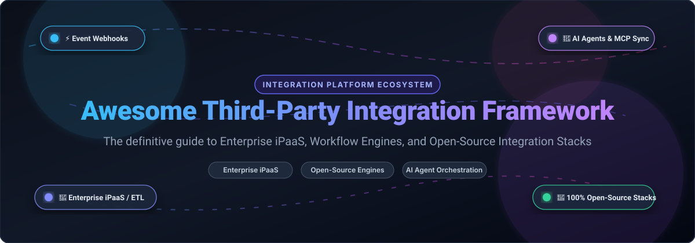

# ⚡ Awesome Third-Party Integration Framework

<p align="center">
  
</p>

<p align="center">
  <a href="https://github.com/ishandutta2007/Awesome-Third-Party-Integration-Framework/stargazers"></a>
  <a href="https://github.com/ishandutta2007/Awesome-Third-Party-Integration-Framework/network/members"></a>
  <a href="https://github.com/ishandutta2007/Awesome-Third-Party-Integration-Framework/blob/main/LICENSE"></a>
  <a href="https://github.com/sindresorhus/awesome"></a>
</p>

> 🚀 **The definitive curated directory and ecosystem comparison of Third-Party Integration Frameworks, Enterprise iPaaS (Integration Platform as a Service), API Connectors, ETL/ELT pipelines, and Open-Source Workflow Automation Engines.**  
> 
> Discover high-performance solutions for interconnecting SaaS platforms, microservices, REST/GraphQL APIs, databases, message brokers, and autonomous AI agents with low-code visual builders or code-first developer frameworks.
> 
> 🌟 **Star this repository to bookmark and follow industry updates!** 🌟

---

## 📑 Table of Contents

- [🌐 Sector Overview & Market Dynamics](#-sector-overview--market-dynamics)
- [🏢 SaaS & Hosted Commercial Platforms](#-saas--hosted-commercial-platforms)
- [🔓 Open-Source Integration Frameworks & Engines](#-open-source-integration-frameworks--engines)
- [⚖️ Feature Matrix & Architecture Comparison](#️-feature-matrix--architecture-comparison)
- [💡 How to Choose an Integration Framework](#-how-to-choose-an-integration-framework)
- [🤝 Contributing](#-contributing)
- [📜 License](#-license)

---

## 🌐 Sector Overview & Market Dynamics

The global **Integration Platform as a Service (iPaaS)** market is estimated at **$8.5 billion to $10.2 billion** and is projected to expand past **$45 billion by 2032** with an accelerating compound annual growth rate (CAGR) of over **25–30%**, propelled by enterprise cloud migration, API-first architecture adoption, SaaS ecosystem sprawl, and autonomous AI agent orchestration.

The market displays a **hybrid competitive landscape: moderately concentrated at the high-end enterprise tier**, where legacy titans (Salesforce MuleSoft, Boomi, Workato) capture the majority of Fortune 500 spend, **yet highly fragmented across mid-market, developer, and niche segments** where modern low-code tools (Make), embedded workflow providers (Tray.io), and high-growth open-source platforms (n8n, Activepieces, Airbyte, Temporal) consistently disintermediate legacy vendors with superior developer experience, transparent pricing, and self-hosted control.

---

## 🏢 SaaS & Hosted Commercial Platforms

Below is a detailed breakdown of leading commercial Third-Party Integration Platforms, sorted by **Valuation / Annual Recurring Revenue (ARR)** in descending order:

| 🏷️ Platform | 💰 Valuation / Company Scale | 💵 Starting Tier Pricing | 🎁 Free Tier / Trial Limit | 🎯 Core Focus & Architectural Strengths |
|---|---|---|---|---|
| **[MuleSoft Anypoint](https://www.mulesoft.com/)** | **$6.5B+** *(Acquired by Salesforce for $6.5B; $1.5B+ ARR)* | **$2,000 / month** ($24,000/yr annual contract baseline for Integration Starter) | **30-day free trial** (Full Anypoint design center access, 1 trial vCore, no production SLAs) | Enterprise API-led connectivity, DataWeave transformations, full lifecycle API governance, and hybrid on-premise/cloud runtimes. |
| **[Workato](https://www.workato.com/)** | **$5.7B** *(Valued at $5.7B Series E; ~$200M ARR)* | **$75 / month** (Pro self-serve tier; Enterprise contracts start at $10,000–$25,000/yr) | **Free Forever Tier**: 50,000 free credits one-time grant + community recipes; 30-day Enterprise trial | Enterprise recipe-based workflow orchestrations, dual citizen/IT developer UX, pre-built governance, and MCP AI connector tools. |
| **[Boomi](https://boomi.com/)** | **$4.0B** *(Acquired for $4B by TPG/Francisco Partners; ~$500M ARR)* | **$99 / month** (Pay-as-you-go Base; Professional bundles start at $2,000/month) | **30-day free trial** with full platform capabilities, pre-built connector testing, and unlimited test runs | Cloud-native iPaaS with visual data mapper, Atoms runtime architecture, and deep legacy ERP (SAP, Oracle, NetSuite) integration depth. |
| **[Make](https://www.make.com/)** | **~$1.5B** *(Subsidiary of Celonis, valued at $11B+; Make ARR ~$60M+)* | **$9 / month** (Core Plan billed annually at $108/yr or $10.59/mo monthly) | **Free Forever Tier**: 1,000 operations/month, 100 MB data transfer, 2 active scenarios, 15-minute execution intervals | Granular visual scenario designer, visual execution flow debuggers, raw HTTP/REST custom endpoints, and complex data-structure iterators. |
| **[SnapLogic](https://www.snaplogic.com/)** | **$1.0B** *(Valued at $1.0B unicorn Series G; ~$100M ARR)* | **$1,650 / month** ($19,800/yr starting baseline for SnapLogic Cloud Starter) | **30-day structured trial** (Requires sales authorization; includes pre-loaded demo pipelines and Snaps) | AI-assisted streaming and batch pipelines (Iris AI), 500+ pre-built Snaps, and RAG/LLM function calling connectivity. |
| **[Tray.io (Tray.ai)](https://tray.io/)** | **$600M** *(Valued at $600M Series C; ~$70M ARR)* | **$750 / month** ($9,000/yr annual contract starting tier for Pro Workspace) | **14-day free trial** of Tray Studio (Includes 1 workspace, 5 active workflows, sandbox environment) | Embedded automation (white-label SaaS integration), low-code visual workflow canvas, JSONata transformation logic, and Tray Merlin AI. |
| **[Celigo](https://www.celigo.com/)** | **$450M** *(Growth equity backed by Summit Partners; ~$80M ARR)* | **$600 / month** ($7,200/yr billed annually for Starter Edition) | **30-day free trial** (Includes 1 integration app, 5 active flows, and full NetSuite sandbox support) | Pre-packaged business process flows (Order-to-Cash, Procure-to-Pay), specialized NetSuite / Shopify / ERP connectors, and SOC 2 Type 2 compliance. |
| **[Jitterbit](https://www.jitterbit.com/)** | **$400M** *(Private equity owned by Audax & KKR; ~$60M ARR)* | **$1,000 / month** ($12,000/yr Standard Package billed annually) | **30-day free trial** (Full access to Harmony Cloud Studio, test sandboxes, API Manager, and EDI mapper) | Hybrid integration studio, legacy EDI translation for supply-chain vendors, enterprise CRM-to-ERP synchronizations, and API Gateway management. |

---

## 🔓 Open-Source Integration Frameworks & Engines

The open-source third-party integration landscape features high-power visual automation engines, event-driven orchestrators, distributed code-first integration frameworks, and high-throughput ELT pipelines.

The projects below are ranked in **descending order by GitHub stargazers**:

### 1. [n8n](https://github.com/n8n-io/n8n) [](https://github.com/n8n-io/n8n/stargazers)
* **Tech Stack:** 🟦 TypeScript / Node.js / Vue.js | **License:** 📄 Sustainable Use License (Source-Available)
* **Key Features:** Fair-code visual workflow automation platform combining 400+ native integrations with custom JavaScript/Python execution nodes. Supports self-hosting via single-container Docker or scalable multi-worker Kubernetes clusters. Offers native LangChain / autonomous AI agent orchestrations, sub-workflow execution, visual step-by-step state inspection, and robust webhook listeners.

### 2. [Huginn](https://github.com/huginn/huginn) [](https://github.com/huginn/huginn/stargazers)
* **Tech Stack:** 💎 Ruby on Rails / MySQL / PostgreSQL | **License:** 📄 MIT
* **Key Features:** A battle-tested open-source system for building automated event-driven agents that read the web, watch for events, and perform API actions on your behalf. Known as a self-hosted, hackable version of Yahoo Pipes or IFTTT, with built-in agent scheduling, deduplication, website scraping, and JSON transformation agents.

### 3. [Appsmith](https://github.com/appsmithorg/appsmith) [](https://github.com/appsmithorg/appsmith/stargazers)
* **Tech Stack:** ☕ Java / TypeScript / React | **License:** 📄 Apache 2.0
* **Key Features:** Open-source platform for rapidly connecting to databases, SaaS APIs, and third-party webhooks to build visual integration frontends, internal tools, and operational workflows. Comes with 50+ pre-built connectors (PostgreSQL, MongoDB, REST APIs, GraphQL, Snowflake) and complete Git-based version control for developer collaboration.

### 4. [Kestra](https://github.com/kestra-io/kestra) [](https://github.com/kestra-io/kestra/stargazers)
* **Tech Stack:** ☕ Java / Micronaut / Vue.js | **License:** 📄 Apache 2.0
* **Key Features:** Universal event-driven declarative orchestrator and integration platform. Define end-to-end multi-system workflows in clean YAML with embedded Python, Node.js, Shell, or SQL code. Features 600+ plugins for cloud providers, analytics databases, and microservices with visual topology graphs, real-time live logs, and automated retry mechanisms.

### 5. [Activepieces](https://github.com/activepieces/activepieces) [](https://github.com/activepieces/activepieces/stargazers)
* **Tech Stack:** 🟦 TypeScript / Angular / Node.js | **License:** 📄 MIT
* **Key Features:** Permissively licensed, 100% open-source alternative to Zapier and n8n with 350+ pre-built integration "pieces" and MCP (Model Context Protocol) servers for AI agents. Designed with an ultra-clean modular architecture that makes writing new TypeScript pieces trivial. Highly popular for embedding white-labeled automations into commercial SaaS products without legal restrictions.

### 6. [Temporal](https://github.com/temporalio/temporal) [](https://github.com/temporalio/temporal/stargazers)
* **Tech Stack:** 🐹 Go / TypeScript / Java / Python / C# | **License:** 📄 MIT
* **Key Features:** Industry-leading durable workflow orchestration engine for complex distributed systems and multi-API integrations. Handles intermittent network timeouts, asynchronous human approvals, state retries, and distributed transaction rollbacks (Saga pattern) entirely through reliable code, eliminating brittle custom retry logic.

### 7. [Node-RED](https://github.com/node-red/node-red) [](https://github.com/node-red/node-red/stargazers)
* **Tech Stack:** 🟩 JavaScript / Node.js | **License:** 📄 Apache 2.0
* **Key Features:** Low-code, flow-based visual programming tool for wiring together APIs, hardware devices, and cloud web services. Runs everywhere from low-cost edge hardware (Raspberry Pi) to industrial cloud gateways. Features a vibrant community repository of over 4,000 community nodes and plugins for any protocol (MQTT, WebSockets, TCP, HTTP).

### 8. [Airbyte](https://github.com/airbytehq/airbyte) [](https://github.com/airbytehq/airbyte/stargazers)
* **Tech Stack:** ☕ Java / Python / TypeScript | **License:** 📄 Elv2 (Core code MIT-derived)
* **Key Features:** The standard open-source data movement engine for synchronizing third-party application APIs to databases, data warehouses, and AI vector stores. Features a catalog of 300+ pre-built API connectors (Salesforce, Stripe, Zendesk, GitHub) and a Connector Builder (no-code UI and Python SDK) that enables building custom API connectors in minutes.

### 9. [Windmill](https://github.com/windmill-labs/windmill) [](https://github.com/windmill-labs/windmill/stargazers)
* **Tech Stack:** 🦀 Rust / Svelte / TypeScript / Python | **License:** 📄 AGPLv3 / Apache 2.0
* **Key Features:** Ultra-fast, code-first developer platform that converts Python, TypeScript, Go, Bash, or SQL scripts into production-ready endpoints, scheduled cron jobs, and visual workflows with auto-generated UIs. Designed as a performant open-source alternative to Retool and Temporal, executing sub-millisecond script runs with complete secret management and audit trails.

### 10. [Automatisch](https://github.com/automatisch/automatisch) [](https://github.com/automatisch/automatisch/stargazers)
* **Tech Stack:** 🟦 JavaScript / React / Node.js | **License:** 📄 AGPLv3
* **Key Features:** Self-hosted automation software that serves as a direct, privacy-respecting drop-in alternative to Zapier or Integromat. Keep all business credentials, customer data, and API payloads on your private network to strictly adhere to GDPR and HIPAA data-residency requirements without paying per-action cloud penalties.

### 11. [Apache Camel](https://github.com/apache/camel) [](https://github.com/apache/camel/stargazers)
* **Tech Stack:** ☕ Java | **License:** 📄 Apache 2.0
* **Key Features:** The foundational enterprise integration pattern (EIP) framework with 350+ connectors across databases, message brokers, cloud suites, and protocols. Enables writing complex message routing and protocol translation rules in Java DSL, Spring Boot, YAML, or XML. Features Camel K for native Kubernetes event processing and Camel Karavan for low-code route visual design.

### 12. [Apache NiFi](https://github.com/apache/nifi) [](https://github.com/apache/nifi/stargazers)
* **Tech Stack:** ☕ Java | **License:** 📄 Apache 2.0
* **Key Features:** Industrial-grade real-time data ingestion, transformation, and multi-system data flow automation engine. Features a rich browser-based drag-and-drop canvas, visual data provenance tracking, prioritized queuing, dynamic backpressure thresholds, and end-to-end interactive data routing for high-throughput enterprise pipelines.

### 13. [ByteChef](https://github.com/bytechefhq/bytechef) [](https://github.com/bytechefhq/bytechef/stargazers)
* **Tech Stack:** ☕ Java / TypeScript / React | **License:** 📄 Apache 2.0
* **Key Features:** Modern open-source platform specifically architected for both standalone workflow automation and embedding within SaaS applications. Features a visual canvas with 260+ pre-built connectors, JavaScript/Python/Java code execution nodes, AI agents as first-class workflow steps, and multi-tenant customer credential delegation.

### 14. [WSO2 Enterprise Integrator](https://github.com/wso2/product-ei) [](https://github.com/wso2/product-ei/stargazers)
* **Tech Stack:** ☕ Java / Ballerina | **License:** 📄 Apache 2.0
* **Key Features:** Enterprise-grade hybrid integration platform delivering comprehensive API gateway capabilities, ESB message brokering, asynchronous event routing, and visual data transformation. Widely trusted by telecom and financial enterprises as a battle-tested open-source substitute for MuleSoft and IBM MQ.

---

## ⚖️ Feature Matrix & Architecture Comparison

| 🛠️ Platform | 📜 License Model | 💻 Primary Stack | 🎨 Visual Builder | 💻 Code Extensibility | 🏠 Self-Hostable | 🎯 Best Architectural Fit |
|---|---|---|---|---|---|---|
| **MuleSoft Anypoint** | Commercial SaaS | Java / Cloud | ✅ Full Canvas | DataWeave / Java | ❌ (Hybrid agent only) | Large-scale enterprise API governance & legacy systems |
| **Workato** | Commercial SaaS | Ruby / Go / Cloud | ✅ Recipe Builder | Custom Connector SDK | ❌ Managed Cloud | Enterprise automation bridging citizen integrators and IT |
| **Boomi** | Commercial SaaS | Java / Cloud | ✅ Drag-and-Drop | Groovy / JavaScript | ❌ (Local Atom runtime) | Hybrid enterprise ERP, CRM, and EDI data pipelines |
| **Make** | Commercial SaaS | Node.js / Cloud | ✅ Scenario Flow | JavaScript / HTTP | ❌ Managed Cloud | Visual multi-step integrations with deep JSON data shaping |
| **SnapLogic** | Commercial SaaS | Java / Cloud | ✅ Flow Canvas | Python / JavaScript | ❌ (Groundplex worker) | AI-powered data pipelines, big data, and cloud data warehouses |
| **Tray.io** | Commercial SaaS | Node.js / Cloud | ✅ Visual Studio | JSONata / Connector SDK | ❌ Managed Cloud | Embedded customer-facing automations in SaaS products |
| **Celigo** | Commercial SaaS | Node.js / Cloud | ✅ Workflow Builder | JavaScript hooks | ❌ Managed Cloud | Turnkey e-commerce & NetSuite/Salesforce business flows |
| **Jitterbit** | Commercial SaaS | C++ / Java / Cloud | ✅ Harmony Studio | Jitterbit Script / JS | ❌ (Local agent available) | Legacy supply chain EDI, B2B gateways, and mid-market ERP |
| **n8n** | Sustainable Use | TypeScript / Node | ✅ Visual Graph | JavaScript / Python | ✅ Docker & K8s | Flexible self-hosted automation with AI agent nodes |
| **Huginn** | MIT | Ruby on Rails | ⚠️ Graph View | Ruby Agents | ✅ Docker / Bare metal | Event-driven web monitors, data watchers, and scraping bots |
| **Appsmith** | Apache 2.0 | Java / React | ✅ Widget Canvas | JavaScript queries | ✅ Docker & K8s | Internal tool dashboards with multi-API integrations |
| **Kestra** | Apache 2.0 | Java / Micronaut | ✅ Topology Graph | YAML + Python/Node/SQL | ✅ Docker & K8s | Declarative, GitOps-friendly data & API orchestrations |
| **Activepieces** | MIT | TypeScript | ✅ Flow Canvas | TypeScript / NPM | ✅ Docker & K8s | Permissively licensed, white-labelable Zapier alternative |
| **Temporal** | MIT | Go / Polyglot | ❌ Code-first UI | Python / TS / Go / Java | ✅ Docker & K8s | Mission-critical distributed systems & stateful microservices |
| **Node-RED** | Apache 2.0 | JavaScript / Node | ✅ Visual Canvas | JavaScript function nodes | ✅ Edge, IoT, Docker | Lightweight edge automation, WebSockets, and IoT gateways |
| **Airbyte** | Elv2 / MIT | Java / Python | ✅ Web UI | Python Connector SDK | ✅ Docker & K8s | High-volume ELT pipeline extraction from third-party APIs |
| **Windmill** | AGPLv3 / Apache | Rust / Svelte | ✅ Low-code Canvas | Python / TS / Rust / Go | ✅ Docker & K8s | High-performance developer scripts, background tasks & UIs |
| **Automatisch** | AGPLv3 | Node.js / React | ✅ Clean Canvas | Pre-built apps | ✅ Docker | GDPR/HIPAA-compliant, private-cloud Zapier alternative |
| **Apache Camel** | Apache 2.0 | Java | ⚠️ Karavan Designer | Java / YAML / XML DSL | ✅ JVM / K8s / Quarkus | Enterprise Java development teams adopting EIP standards |
| **Apache NiFi** | Apache 2.0 | Java | ✅ DataFlow Canvas | Java processors / Jython | ✅ Bare metal / Docker | Real-time enterprise data streams with backpressure control |
| **ByteChef** | Apache 2.0 | Java / TS | ✅ Flow Editor | JS / Python / Java | ✅ Docker & K8s | Native SaaS embedding and AI agent workflow automation |
| **WSO2 EI** | Apache 2.0 | Java / Ballerina | ⚠️ Integration Studio | Ballerina / Java / XML | ✅ VMs / Containers | High-throughput enterprise ESB and API management |

---

## 💡 How to Choose an Integration Framework

```
What is your primary architectural requirement?
│
├── 🏢 Enterprise Governance & Turnkey Support
│   ├── Large Budget & API-Led Architecture ──► MuleSoft Anypoint
│   ├── Business User / IT Hybrid Recipes   ──► Workato
│   └── Legacy ERP / EDI / Manufacturing    ──► Boomi or Jitterbit
│
├── 💻 Developer Code-First Orchestration
│   ├── Mission-Critical Microservice States ──► Temporal
│   ├── Declarative GitOps Multi-Cloud YAML  ──► Kestra
│   ├── Enterprise Java EIP Standards        ──► Apache Camel
│   └── Polyglot High-Performance Scripts    ──► Windmill
│
├── 🎨 Visual Low-Code / No-Code Automation
│   ├── Self-Hosted AI Agents & Workflows    ──► n8n
│   ├── Permissive MIT White-Label Embedding ──► Activepieces or ByteChef
│   ├── Granular Cloud Scenario Data Shaping ──► Make
│   └── GDPR / Private Cloud Zapier Drop-in  ──► Automatisch
│
└── 📊 High-Volume Data Replication & Streaming
    ├── API-to-Warehouse ELT Pipelines       ──► Airbyte
    └── Real-time Flow & Edge IoT Processing ──► Apache NiFi or Node-RED
```

---

## 🤝 Contributing

Contributions are warmly welcomed! Help expand this directory by adding new open-source integration frameworks or updating existing details:

1. 🍴 Fork the repository.
2. 🌿 Create a feature branch: `git checkout -b feature/new-integration-framework`.
3. ✍️ Add your project in the appropriate table and list (with project name, GitHub star badge, license, stack, and architectural highlight).
4. 📬 Submit a Pull Request with a short summary of why the framework stands out.

---

## 📜 License

This compilation is licensed under the [Creative Commons Zero v1.0 Universal (CC0 1.0)](LICENSE) Public Domain Dedication.  
All listed software projects, trademarks, and logos are property of their respective creators.

---

<p align="center">
  ⭐ <b>Found this resource helpful? Give it a star to show your support!</b> ⭐
</p>
